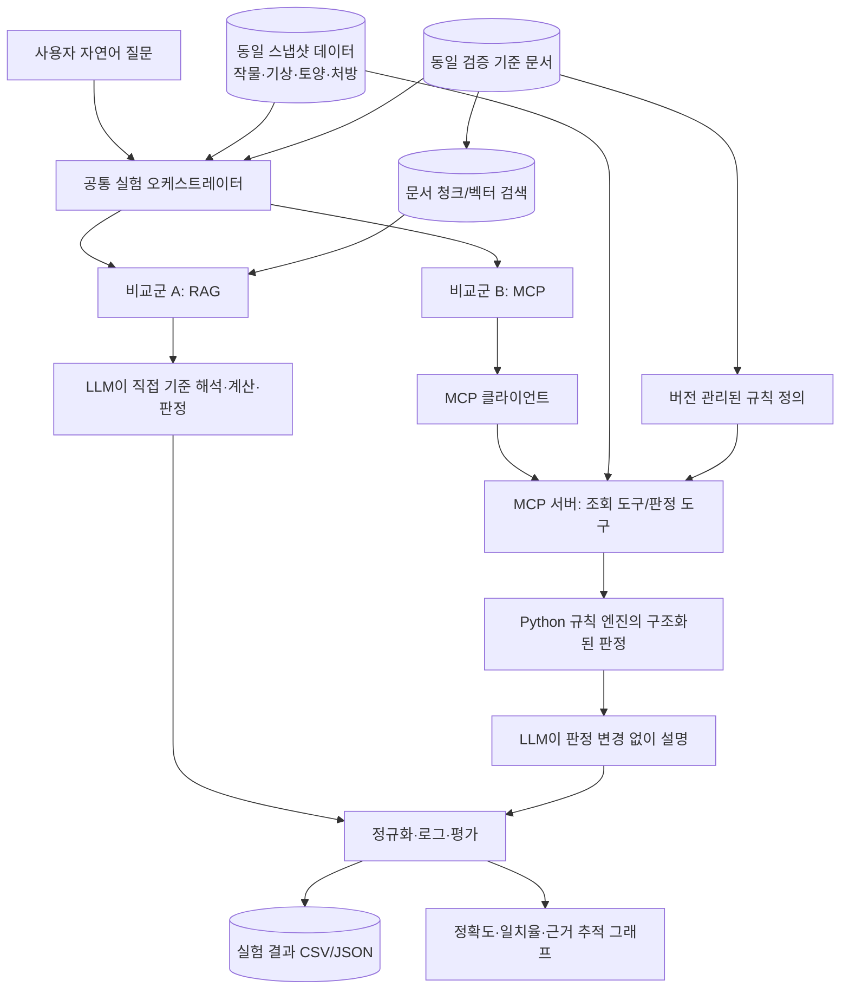

# Codex 개발 명세서: 다중 출처 농업 데이터를 연계한 MCP 기반 LLM 의사결정지원시스템

> **목적:** 이 문서를 Codex에 전달하여 학회 포스터 발표를 위한 재현 가능한 연구용 프로토타입을 단계적으로 구현한다.
>
> **기준 초록:** 「다중 출처 농업 데이터를 연계한 MCP 기반 LLM 의사결정지원시스템 개발」 (2026 추계 생물환경조절학회, 전혜진 외)
>
> **문서 성격:** 원문 초록의 연구 목적·방법론을 구현 가능한 개발 명세로 확장한 **제안 설계**다. 초록에서 구체적으로 밝히지 않은 기술 스택, 파일 구조, 시나리오 수, 데이터 형식, 계산식은 개발 편의를 위한 권장안이며 검증된 연구 결과나 원문에 명시된 사실로 취급하지 않는다.

---

## 0. Codex에 전달할 실행 지시

당신은 Python 기반 연구용 소프트웨어 개발 담당자다. 아래 사양을 따라 **RAG 방식(LLM 직접 판정)**과 **MCP 방식(규칙 기반 도구 판정 + LLM 설명)**을 동일 조건으로 비교하는 프로토타입을 구현하라.

개발 원칙:

1. **먼저 실행 가능한 최소 기능(MVP)**부터 만든다: 관수 판정 → MCP 연동 → RAG 비교군 → 반복 평가 → 필요 시 시비·환경제어 확장.
2. 모든 판정은 **입력값·출처·규칙 버전·중간 계산값·최종 결과**를 추적 가능하게 남긴다.
3. MCP 경로에서 **최종 판정은 Python 규칙 엔진**이 소유한다. LLM은 판정을 임의로 수정하지 않고 결과만 설명한다.
4. RAG 경로에서는 동일한 기준 문서와 입력 자료를 검색·활용하지만 **LLM이 직접 조건 해석·계산·최종 판정**하도록 한다.
5. 농촌진흥청·흙토람의 **실제 수치 기준을 확보하기 전까지 임의의 임계값을 실제 농업 처방처럼 사용하지 않는다.** 예시 수치는 `demo_only`로 표시하고, 연구 평가에서는 검증된 기준만 사용한다.
6. API 키와 외부 서비스가 없어도 **로컬 데모 데이터, Mock LLM, 자동 테스트**까지 실행되도록 설계한다. 실제 LLM 평가에서는 Mock 대신 두 비교군에 동일한 모델을 사용한다.
7. 먼저 프로젝트 구조와 작업 순서를 제시하고, 각 단계 완료 시 테스트를 실행하여 오류를 수정한다. 실험 지표와 결과는 **실측하지 않고 미리 생성·조작하지 않는다.**
8. 불명확한 값은 합리적으로 선택하여 `README.md`에 **가정**으로 기록하고, 출처가 필요한 항목은 `TODO`로 남긴다.

### 가장 먼저 만들 결과물

- `README.md`: 설치/실행/실험 절차 및 개발 가정
- 공통 입력 데이터 스키마 + 로컬 샘플 데이터
- 관수 규칙 판정 함수 및 단위 테스트
- MCP 서버와 MCP Tool 호출 테스트
- RAG 직접 판정 경로
- 10회 반복 실험 스크립트 및 결과 CSV
- 비교 분석 그래프와 포스터에 사용할 시스템 구성도(Mermaid 문서 가능)

---

## 1. 원문 초록에 명시된 연구 범위

### 1.1 연구 목적

다중 출처 농업 데이터를 MCP(Model Context Protocol)로 연계하는 의사결정지원시스템을 구축하고, MCP 활용 여부에 따라 LLM 응답의 **판정 정확도, 반복 일치율, 근거 추적 가능 여부**가 어떻게 달라지는지 비교한다.

### 1.2 입력 및 기능

- 사용자 입력: 농업 관련 자연어 질문
- 조회 정보: **작물 상태, 기상, 토양, 처방 정보**
- 의사결정 영역: **관수, 시비, 환경제어 방향**
- 기준 자료: **농촌진흥청 및 흙토람 기준**

### 1.3 두 비교군

| 비교군 | 데이터와 기준 활용 | 판정 주체 | LLM의 역할 |
|---|---|---|---|
| A — RAG 직접 판정 | 동일 기준 문서를 RAG로 검색 | LLM | 기준 해석, 조건 판단, 계산, 결과 작성 |
| B — MCP 규칙 판정 | MCP Tool로 정보 조회 및 판정 | 규칙 기반 Python Tool | 도구 선택, 도구 호출, 판정 결과 설명 |

### 1.4 초록의 평가 설계

- 시나리오 유형: **기준값 경계, 복합 조건, 수치 계산, 정보 누락**
- 평가 방식: 동일한 질문을 **각 10회 반복 질의**
- 비교 지표: **판정 정확도, 판정 일치율, 근거 추적 가능 여부**

**주의:** 초록에는 MCP 활용군에서 일관성과 근거 추적이 나타났다는 관찰이 서술되어 있으나, 이 문서만으로 원자료·표본 수·정확한 수치·평가 코드를 확인할 수는 없다. 새로운 구현의 실험 결과를 초록의 기존 결과와 동일하다고 가정하지 말 것.

---

## 2. 전체 시스템 아키텍처



**MCP에 대한 정확한 해석:** MCP는 모델과 외부 데이터/도구 간 연계 프로토콜이다. 응답 일치성은 MCP 표준 자체가 아니라 **고정된 데이터에 대해 결정적으로 수행되는 규칙 엔진**에서 확보한다.

---

## 3. 기술 스택(권장, 초록에 명시된 사항은 아님)

| 계층 | 우선 도구 | 비고 |
|---|---|---|
| 언어 | Python 3.11+ | 로직·실험 통합 |
| MCP | 공식 Python MCP SDK | 실제 설치 버전의 최신 API에 맞춰 작성 |
| 애플리케이션 | FastAPI(선택) | 초기에는 CLI만으로도 충분 |
| UI | Streamlit(선택) | 마지막에 시연용으로 추가 |
| 저장소 | SQLite + CSV/JSON | 실험 스냅샷·로그 저장 |
| RAG | ChromaDB + 임베딩 모델 | 같은 기준 문서 검색 |
| LLM | 환경 변수 기반 교체 가능한 어댑터 | 두 비교군 동일 공급자·모델·설정 |
| 분석 | pandas, matplotlib | 표·그래프 저장 |
| 테스트 | pytest | 규칙/경계/반복 시험 |
| 설정 | YAML 또는 JSON | 임계값·출처·버전 관리 |

API 키는 `.env`에서 읽고 `.gitignore`로 제외한다. 외부 API 장애나 호출 비용을 통제하기 위해 **평가 시에는 고정된 스냅샷을 기본값**으로 사용한다.

---

## 4. 단계별 개발 계획

### STEP 1. 농업 데이터 및 출처 관리

**목표:** 두 비교군이 같은 입력을 참조하도록 공통 데이터셋과 메타데이터를 구축한다.

데이터 범주:

1. 작물 정보: `crop`, `growth_stage`, `crop_status`
2. 기상 정보: `air_temperature_c`, `relative_humidity_pct`, `forecast_rain_mm`, `forecast_timestamp`
3. 토양 정보: `soil_moisture_value`, `soil_moisture_unit`, `soil_ph`, `nutrient_values`
4. 처방 기준: `criterion_id`, `threshold`, `operator`, `unit`, `applicable_crop`, `applicable_stage`, `source_document`, `source_url`, `source_version`

권장 구현:

- `data/snapshots/*.json`: 평가에 사용할 정적인 입력 스냅샷
- `data/references/`: 검증된 출처 문서와 메타데이터
- `src/schemas/`: Pydantic 모델 등 입력 검증
- 값이 없는 경우 `null`로 보존하며, **0을 결측 대용값으로 쓰지 않는다.**
- 토양수분은 부피수분함량(%), 센서 원시 ADC 값 등 단위가 다르므로 반드시 단위를 명시하고, 서로 다른 단위를 비교하지 않는다.

완료 조건:

- 유효한 입력 JSON 로딩
- 누락 필드·미지원 단위 검증
- 동일 스냅샷 ID로 재실행 가능

### STEP 2. 근거 문서와 판정 규칙 정리

**목표:** 기준 출처를 식별하고, 모호한 자연어 기준을 명시적인 조건식으로 전환한다.

규칙 정의의 예시 구조:

```yaml
rule_id: irrigation_demo_001
version: "0.1.0-demo"
status: demo_only  # 검증 전 예시 규칙. 실제 연구 평가 사용 금지.
domain: irrigation
applicable_crop: demo_crop
applies_to_stage: demo_stage
input_field: soil_moisture_value
input_unit: percent_vwc
operator: "<"
threshold: null  # 공식 출처 확인 후 입력
on_true: IRRIGATION_REQUIRED
on_false: IRRIGATION_NOT_REQUIRED
source:
  organization: null
  document_title: null
  url: null
  retrieved_at: null
  page_or_section: null
```

구현 원칙:

- `<`/`<=`/`>`/`>=` 경계 연산을 정확히 구분
- 적용 작물/생육단계/단위를 검증
- 시비량·관수량 계산에 필요한 모든 변수의 단위 검사
- 출처 미확인 또는 필수 입력 누락 시 **`INSUFFICIENT_INFORMATION`** 반환
- 기준 미정 상태에서 그럴듯한 결과를 임의로 산출하지 않음

완료 조건: 각 규칙에 출처·버전·입력·조건·판정결과가 연결됨.

### STEP 3. Python 규칙 엔진 구현

**목표:** LLM 없이 동일 입력 → 동일 결과를 보장하는 순수 함수를 작성한다.

예상 인터페이스:

```python
from typing import Any

def evaluate_irrigation(snapshot: dict[str, Any], rule: dict[str, Any]) -> dict[str, Any]:
    """Return a deterministic decision with provenance or an explicit error."""
    ...

def evaluate_fertilization(snapshot: dict[str, Any], rule: dict[str, Any]) -> dict[str, Any]:
    ...

def evaluate_environment(snapshot: dict[str, Any], rule: dict[str, Any]) -> dict[str, Any]:
    ...
```

표준 판정 응답 스키마(제안):

```json
{
  "case_id": "CASE-001",
  "domain": "irrigation",
  "decision": "IRRIGATION_REQUIRED",
  "decision_code": "RULE_MATCH",
  "numeric_result": null,
  "numeric_unit": null,
  "inputs_used": {},
  "rule_id": "rule_001",
  "rule_version": "1.0.0",
  "calculation_steps": [],
  "source_refs": [],
  "missing_fields": [],
  "error": null
}
```

`decision`은 영역별 고정된 Enum으로 관리한다. `IRRIGATION_REQUIRED`, `IRRIGATION_NOT_REQUIRED`, `INSUFFICIENT_INFORMATION` 등. 실제 관수·시비 처방의 수치 계산은 공식 기준식과 단위 검증이 확보된 경우에만 추가한다.

완료 조건:

- 동일 입력 100회 반복 시 JSON 정규화 판정값 일치
- 경계값·누락값·상충 조건 테스트 통과
- 계산·출처 필드 검증

### STEP 4. MCP 서버 구축

**목표:** 조회 및 규칙 엔진을 MCP 도구로 노출한다.

권장 도구:

| Tool 이름 | 필수 기능 |
|---|---|
| `get_crop_status` | 작물/생육단계 조회 |
| `get_weather_data` | 실험 스냅샷의 기상 자료 조회 |
| `get_soil_data` | 토양 자료·단위 조회 |
| `get_prescription` | 관련 기준, 버전, 출처 조회 |
| `evaluate_irrigation` | 규칙 기반 관수 판정 |
| `evaluate_fertilization` | 규칙 기반 시비 판정 |
| `evaluate_environment` | 규칙 기반 환경제어 판정 |

규칙:

- Tool은 구조화된 JSON을 반환한다.
- 모든 조회는 `snapshot_id` 또는 `case_id`로 고정된 데이터를 참조한다.
- 판정 도구는 Step 3의 순수 함수를 호출한다.
- 도구 오류/타임아웃/데이터 누락은 표준 오류 코드로 반환한다.
- 도구 실행 기록에 요청 ID, 도구명, 입력 식별자, 규칙 버전, 결과 해시 등을 기록한다.

완료 조건: MCP 클라이언트에서 최소 `get_soil_data`와 `evaluate_irrigation` 호출 성공. SDK 버전에 맞는 통합 테스트를 포함한다.

### STEP 5. MCP + LLM 경로 구현(실험군 B)

**목표:** 자연어 질문 → 도구 호출 → 규칙 판정 → LLM 설명의 실행 체인을 만든다.

동작:

1. 입력 질문에서 대상 작물/상황/필요 도구 확인
2. 필요한 MCP 조회 도구 호출
3. 규칙 판정 도구 호출
4. 도구가 반환한 `decision`, `numeric_result`, `rule_id`는 **LLM 설명 출력과 분리 저장**
5. LLM이 판단을 새로 내리지 않고 판정·근거·불확실성을 설명

**중요:** 정확도 측정 대상은 LLM이 다시 생성한 문장보다 **도구가 반환한 구조화된 판정값**으로 한다. 사용자 표시문이 판정과 충돌하면 `explanation_conflict=true`로 따로 로그를 남긴다.

완료 조건: 임의 판정 수정 없이 도구 결과를 설명하고, 모든 Tool Call 추적이 가능함.

### STEP 6. 비교용 RAG 직접 판정 경로 구현(비교군 A)

**목표:** 동일 기준 문서와 데이터를 활용하면서 최종 조건 판단·계산을 LLM이 수행하도록 한다.

동작:

1. 농촌진흥청·흙토람 기준 문서의 검증된 텍스트를 청크화
2. 동일 문서 집합의 임베딩 및 벡터DB 구축
3. 질문에 맞는 기준 문서 검색
4. 같은 데이터 스냅샷을 LLM 프롬프트에 전달
5. LLM이 직접 규칙 해석·계산·판정을 수행하고 JSON으로 응답

추천 표준화 출력:

```json
{
  "case_id": "CASE-001",
  "decision": "IRRIGATION_REQUIRED",
  "numeric_result": null,
  "numeric_unit": null,
  "rationale": "...",
  "cited_sources": ["..."],
  "insufficient_information": false
}
```

비교 공정성 조건:

- 같은 LLM 모델/버전, 가능한 동일한 온도·샘플링 설정
- 같은 질문 문구, 같은 작물·기상·토양 스냅샷
- 같은 기준 문서 **원본 내용** 사용
- 시스템별로 달라야 하는 요소는 **판정 수행 위치**(LLM 직접 vs 규칙 도구)와 그에 필요한 도구 형태
- RAG 검색 실패 및 해당 기준 미검색은 **별도로 로그**를 남겨 분석
- 실험마다 문서 인덱스/프롬프트/규칙/모델 버전을 고정

완료 조건: RAG 검색 근거와 LLM 판정이 함께 저장되고, MCP 경로와 동일한 평가 파이프라인으로 투입 가능.

### STEP 7. 실험 시나리오 및 반복 평가

**목표:** 초록에 명시된 네 가지 유형의 질문을 두 방식에 대해 각각 10회 반복한다.

| 시나리오 유형 | 검증 포인트 | 설계 예시 |
|---|---|---|
| 기준값 경계 | `<`, `<=` 등의 연산 정확성 | 입력이 기준보다 낮음/같음/높음 |
| 복합 조건 | 결합 규칙·우선순위 | 건조 조건 + 강수 예보 동시 입력 |
| 수치 계산 | 계산 재현성, 단위, 오차 | 면적·관수 기준을 이용한 필요량 산출 |
| 정보 누락 | 근거 부족 시 처리 | 토양수분 값 없는 관수 질문 |

**권장 초기 실험 설계(원문에 시나리오 개수는 없음):** 4유형 × 유형당 3사례 = **12개 사례**. 각 사례를 RAG/MCP 두 방식에서 10회씩 실행하면 **총 240건**이다. 최종 사례 수는 연구자가 조정할 수 있도록 설정 파일로 관리한다.

사례 파일 예시:

```json
{
  "case_id": "EDGE-001",
  "category": "threshold_boundary",
  "question": "기준과 토양수분 값이 같을 때 관수가 필요한가?",
  "snapshot_id": "snapshot_edge_001",
  "rule_id": "verified_rule_001",
  "expected_decision": "IRRIGATION_NOT_REQUIRED",
  "expected_numeric_result": null,
  "numeric_tolerance": null,
  "expected_source_ids": ["verified_source_001"]
}
```

위의 `expected_decision`은 **연산자가 `<`인 검증된 규칙을 사용하는 경우의 예시**다. 실제 공식 기준을 조사하기 전에 임의 기준을 연구용 정답으로 확정하지 말 것.

반복 평가 절차:

1. 기준 문서 버전·스냅샷·질문·모델 설정·규칙 버전 고정
2. 필요하면 각 반복을 독립 대화 세션에서 시작(맥락 누적 방지)
3. 사례마다 A/B를 각각 10회 실행(가능하다면 호출 순서 균형 조정)
4. 원문 응답, 정규화 판정, 수치 결과, 참조 근거, latency, 오류, 토큰 사용량(가능한 경우) 저장
5. 결과를 CSV 및 JSONL로 출력; 호출 실패는 삭제하지 않고 별도 상태로 표시
6. 실행 시드 및 비결정성을 통제할 수 있는 모델 옵션을 기록

완료 조건: 실행 명령 한 번으로 사례별 반복 테스트가 수행되고 결과 파일 생성.

### STEP 8. 평가 지표·그래프·포스터 자료 생성

**목표:** 보고 가능한 지표와 재현 가능한 시각화 자동 생성.

기본 지표:

1. **판정 정확도** = `(정답 판정 수 / 평가 가능한 판정 수) × 100`.
2. **판정 일치율** = 각 사례에서 `가장 빈번한 판정 횟수 / 해당 사례 유효 응답 수 × 100`의 사례별 값 및 전체 평균. 정답 여부와는 별개 지표임.
3. **근거 추적 가능 비율** = 판정에 사용된 **원문 출처 + 규칙 ID + 적용 입력/계산 흐름**을 검증 가능한 응답 수 / 평가 가능한 응답 수 × 100.

평가 규정(미리 고정):

- `INSUFFICIENT_INFORMATION`이 정답인 사례는 유효한 정답 범주로 처리
- JSON 파싱 실패 및 도구 오류는 별도 실패율로 집계하고, **분모에서 제외한 결과와 전체 시도 기준 결과를 함께 보고**
- 수치 계산 정확도는 공식 기준의 기대값과 사전 정의한 단위/허용 오차로 판정
- 정확도와 일치율은 다르다. 10회 전부 같은 오답이어도 일치율은 100%다.
- RAG는 도구가 없으므로 근거 추적 시 `인용 출처 + 입력 변수 + 식/계산 과정` 등을 평가하고, MCP는 규칙 실행 로그까지 추가로 확인한다. 공통 기준과 추가 증거 수준을 분리해 보고하여 불공정한 지표를 피한다.

자동 생성 산출물:

- `outputs/results/experiment_runs.csv`
- `outputs/results/experiment_runs.jsonl`
- `outputs/results/metrics_summary.csv`
- `outputs/figures/decision_accuracy.png`
- `outputs/figures/decision_consistency.png`
- `outputs/figures/evidence_traceability.png`
- `outputs/figures/case_comparison.png` (선택)
- `docs/system_architecture.md` (Mermaid)
- `docs/experiment_protocol.md`

**실험 미수행 상태에서는 그래프를 빈 틀로 표시하거나 생성하지 않는다. 가상의 우수 결과를 채우지 않는다.**

---

## 5. 권장 프로젝트 디렉터리

```text
agri-mcp-dss/
├── README.md
├── pyproject.toml
├── .env.example
├── .gitignore
├── configs/
│   ├── app.yaml
│   ├── experiment.yaml
│   └── rules/                     # 검증된 규칙/데모 규칙 구분
├── data/
│   ├── snapshots/                 # 고정된 입력 사례
│   ├── references/                # 근거 문서·출처 메타데이터
│   └── scenarios/                 # 평가 질문, 정답, 허용 오차
├── src/
│   └── agri_dss/
│       ├── schemas/               # 입력/출력 검증 모델
│       ├── datasets/              # 스냅샷 로더 및 출처 관리
│       ├── rules/                 # 순수 판정 함수
│       ├── mcp_server/            # MCP Tools
│       ├── mcp_client/            # MCP 호출 체인
│       ├── rag/                   # 문서 색인/검색
│       ├── llm/                   # 동일 모델 어댑터/JSON 파서
│       ├── experiment/            # 반복 평가·평가자
│       └── visualization/         # 분석 그래프
├── scripts/
│   ├── run_mcp_demo.py
│   ├── run_rag_demo.py
│   ├── build_index.py
│   ├── run_experiment.py
│   └── generate_report.py
├── tests/
│   ├── test_rules.py
│   ├── test_boundary_cases.py
│   ├── test_missing_data.py
│   ├── test_mcp_tools.py
│   └── test_metrics.py
├── docs/
│   ├── system_architecture.md
│   └── experiment_protocol.md
└── outputs/
    ├── results/
    └── figures/
```

프로젝트 규모가 작으면 과도한 클래스 분리보다 핵심 기능 구현을 우선한다.

---

## 6. 반드시 통과해야 할 테스트

- [ ] 기준값보다 작은 값·같은 값·큰 값 각각 올바른 경계 판정
- [ ] 단위가 다른 값을 암묵적으로 비교하지 않음
- [ ] 작물·생육단계가 규칙과 일치하지 않으면 오류 또는 판단 보류
- [ ] 필수 변수가 없으면 `INSUFFICIENT_INFORMATION`
- [ ] 수치 계산은 기대값·단위·허용 오차를 검사
- [ ] 동일 스냅샷/규칙을 100회 입력해 규칙 엔진 판정 완전 일치
- [ ] MCP 도구의 입력/출력이 JSON 스키마에 맞음
- [ ] MCP의 판정값이 LLM 설명 때문에 덮어써지지 않음
- [ ] RAG에 제공된 스냅샷이 MCP와 동일함
- [ ] 10회 반복의 모든 시행 ID와 호출 설정이 기록됨
- [ ] API 실패나 응답 파싱 실패를 결과에서 조용히 제거하지 않음
- [ ] 데이터/문서/모델/규칙 버전이 실험 파일에 보존됨
- [ ] 분석 스크립트가 저장된 결과 파일만으로 동일 지표를 재계산함

---

## 7. 권장 마일스톤과 완료 조건

| 마일스톤 | 구현 범위 | 완료 기준 |
|---|---|---|
| M1 — 데이터/규칙 MVP | 공통 스키마 + 관수 규칙 엔진 | CLI 판정 + 단위 테스트 |
| M2 — MCP 연결 | 조회/관수 Tool + MCP 클라이언트 | 구조화된 판정·근거 출력 |
| M3 — LLM 연동 | MCP 판정 결과 자연어 설명 | LLM에 판정 권한 없음 확인 |
| M4 — RAG 비교군 | 동일 문서/데이터로 직접 판정 | 두 비교군 동일 질문 처리 |
| M5 — 평가 자동화 | 4유형 × 10회 반복 | 원시 응답, 정규화 결과 저장 |
| M6 — 기능 확장 | 시비·환경제어 판정 규칙 | 각 영역 테스트 통과 |
| M7 — 포스터 산출물 | 지표/그래프/구성도 | 실제 결과 기반 재현 가능 |

**우선순위:** M1→M2→M3→M4→M5가 최소 연구 파이프라인이며, 초록의 전체 의사결정 범위를 반영하기 위해 M6(시비·환경제어)까지 확장한다. M7에서 최종 포스터 자료를 작성한다.

---

## 8. Codex 최종 응답 요구사항

Codex는 각 단계 구현 후 다음을 간단히 보고할 것.

1. 신규/수정 파일 목록
2. 설치 및 실행 명령
3. 실행된 테스트와 성공/실패 결과
4. 실제 입력/출력 예시(임계값이 데모인지 검증된 기준인지 구분)
5. 남아 있는 출처 확인·API 키·외부 연동 작업
6. 학회 포스터에 사용 가능한 자료의 저장 위치

특히 **초록의 기존 결론을 실험 전에 사실로 단정하지 말고**, 새 실험에서 검증된 결과를 정확히 표시할 것.

---

## 9. 바로 시작할 작업

Codex는 아래 항목을 **첫 번째 작업 단위**로 진행하라.

1. `agri-mcp-dss/` 프로젝트 초기화 및 패키지/환경 설정
2. `README.md`, `.env.example`, `pyproject.toml` 생성
3. 공통 입력·출력 스키마 정의, 데모 스냅샷·데모 규칙 생성
4. `evaluate_irrigation()` 순수 함수 구현
5. 기준값 미만·동일·초과, 정보 누락, 단위 오류를 검사하는 `pytest` 작성
6. 로컬 CLI로 판정을 출력하고 근거 구조를 확인
7. 테스트 결과를 보고하고 다음 MCP 연결 단계로 넘어갈 수 있는 상태를 만들 것

**주의:** 학술 평가에 사용할 관수/시비/환경제어 공식 수치 기준은 연구자가 제공하거나 검증 가능한 근거 문서에서 확인해야 한다. 출처 미확인 예시값으로 최종 정확도 평가를 수행하지 않는다.
