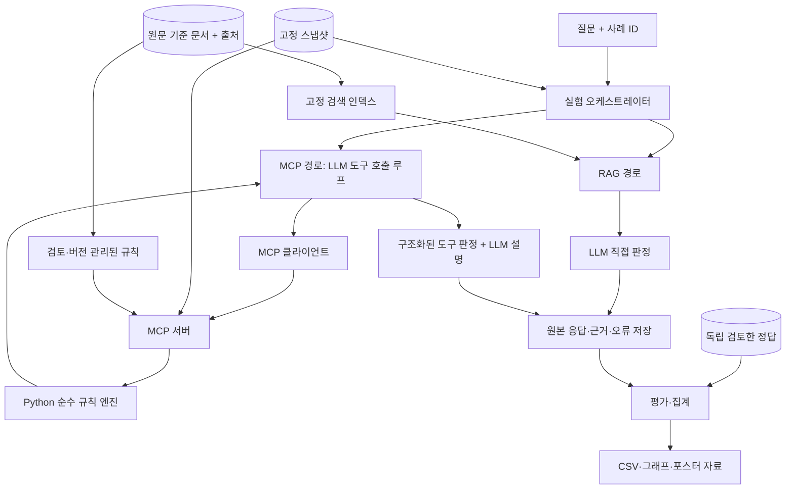

# 농업 의사결정지원시스템 구현 설계

작성일: 2026-11-14  
상태: 초기 구현 설계 / 코드 구현 전  
기준: `Codex_MCP_농업_의사결정지원시스템_개발명세서.md`

제공 자료 검토 후 보완: [데이터·API 연결 설계](data_integration_design.md). 초기 범용 관수 예시와 별도로 토마토의 재배방식·생육단계·수분장력 단위를 확인하고 적용 규칙을 선정한다.

## 1. 목표와 범위

동일한 농업 데이터와 기준 문서를 사용하는 두 경로를 만들고, 판정 정확도·반복 일치율·근거 추적 가능성을 비교한다.

- A: RAG가 기준 문서를 검색하고 LLM이 조건 해석·계산·판정을 수행한다.
- B: LLM이 MCP 도구를 선택·호출하고 Python 규칙 엔진의 판정 결과를 설명한다.
- MCP는 연결 프로토콜이며, 판정의 결정성은 규칙 엔진에서 확보한다.
- 연구용 의사결정지원 프로토타입으로 한정한다. 장비 제어와 자동 관수 실행은 초기 범위에 포함하지 않는다.

첫 구현 단위는 관수 데이터 스키마, 규칙 엔진, CLI와 테스트다. 이후 실제 MCP 통신, LLM, RAG, 반복 평가 순서로 연결한다. 시비·환경제어는 검증된 기준 확보 후 확장한다.

## 2. 주요 설계 결정

| 항목 | 결정 | 이유 |
|---|---|---|
| 프로젝트 위치 | 저장소 루트에 `pyproject.toml`, `src/agri_dss/` 배치 | 현재 디렉터리가 프로젝트 전용이며 중복 하위 폴더가 필요하지 않음 |
| 런타임 | Python 3.11 이상, CLI 우선 | 로컬 재현과 자동 평가를 먼저 확보 |
| 입력 검증 | Pydantic 모델, JSON 파일 | 명시적인 단위와 필수 필드 검증 |
| 설정 | 초기에는 JSON | 데이터·규칙·설정 형식을 통일 |
| 규칙 | 버전 관리된 선언형 조건과 명시적 계산 함수 | 임의 코드 실행 없이 계산 과정을 추적 |
| MCP | 공식 Python SDK, 로컬 stdio | 별도 웹 서버 없이 실제 프로토콜 검증 |
| 저장 | 원본 JSONL, 요약 CSV, 실행 manifest | 작은 실험에 충분하며 저장된 결과만으로 재분석 가능 |
| SQLite | 초기 보류 | 동시 실행·대량 조회가 필요해지면 도입 |
| RAG | 검색기 인터페이스 분리, 연구 경로는 임베딩·벡터 검색 | 검색 모델과 인덱스를 교체하고 버전을 고정 |
| 데모 검색 | 필요 시 로컬 어휘 검색 | 외부 모델 다운로드 없는 동작 점검용; 연구 RAG와 구분 |
| LLM | 공통 어댑터와 Mock 구현 | API 키 없이 실행하고 동일 모델 비교를 강제 |
| UI | 평가 파이프라인 완성 후 선택 | 초기 구현 범위 축소 |

SDK·LLM 공급자 API의 구체적인 호출법과 패키지 버전은 해당 구현 단계에서 공식 문서로 확인하고 잠금 파일로 고정한다. 현재 설계는 특정 최신 버전을 전제하지 않는다.

## 3. 시스템 구성과 데이터 흐름



각 시행은 `run_id / case_id / arm / repetition / attempt_id`로 식별한다. 한 사례의 두 경로는 동일한 스냅샷과 원문 문서 집합의 해시를 공유한다. RAG에는 검색된 원문과 스냅샷을 제공하며, MCP가 계산한 판정이나 실행 로그는 제공하지 않는다.

## 4. 공통 데이터 계약

| 모델 | 핵심 필드와 제약 |
|---|---|
| `Snapshot` | ID, 버전, 관측 시각, 작물·생육단계, 기상, 토양, 각 자료의 출처 ID |
| `SourceDocument` | 출처 ID, 기관, 제목, URL 또는 로컬 경로, 취득 시각, 문서 버전·해시, 쪽/절, 검증 상태 |
| `Rule` | ID·버전, `demo_only/verified`, 적용 작물·단계, 입력 단위, 조건, 결과, 출처의 쪽/절, 검토 기록 |
| `DecisionResult` | 판정, 이유 코드, 사용 입력, 규칙 ID·버전, 중간 계산, 수치·단위, 출처, 누락 필드 |
| `Scenario` | 유형, 질문, 스냅샷·규칙 참조, 기대 판정·수치·단위·허용오차, 정답 검토 기록 |
| `TrialResult` | 시행 식별자, 실행 상태, 원문 응답, 정규화 판정, 검색/도구 로그, 지연·토큰, 설명 검사 상태 |
| `RunManifest` | 모드, 모든 입력 해시, 코드 식별자, 의존성, 프롬프트·검색·모델 설정, 실행 순서·시드 |

- 누락값은 `null`이다. 0은 유효한 수치로 보존한다.
- 값이 누락된 것과 필드명·자료형이 잘못된 것은 구별한다.
- 단위 불일치, 적용 작물·단계 불일치, 필요한 출처 부족은 이유 코드를 붙여 판단 보류한다.
- NaN·무한대와 물리적으로 불가능한 값은 입력 오류로 처리한다. 허용 범위는 변수 정의에 기록한다.
- 단위 변환은 검증된 변환 함수가 있을 때만 수행하며 변환 내역을 남긴다.
- 날짜·시각은 시간대가 있는 형식으로 저장한다. 예보의 유효 시간도 스냅샷에 고정한다.

업무상 판단 보류(`INSUFFICIENT_INFORMATION`)는 정상 판정 범주다. 파일 손상, 프로토콜 오류, API 실패는 실행 오류로 분리한다.

## 5. 규칙 엔진

핵심 인터페이스는 `evaluate_irrigation(snapshot, rule, mode) -> DecisionResult`다. 파일·네트워크·현재 시각·LLM을 참조하지 않는 순수 함수로 구현한다.

처리 순서:

1. 입력 구조와 숫자 유효성 검사.
2. 실행 모드와 규칙 검증 상태 확인.
3. 출처·임계값·작물·생육단계·단위·필수 변수 확인.
4. 명시된 연산자와 조건 우선순위에 따라 계산.
5. 사용 입력, 조건별 참/거짓, 계산값, 출처와 판정을 반환.

M1에서는 단일 수분 임계값 비교만 구현한다. 데모 임계값은 합성 작물·합성 문서에만 연결하고 실제 농업 기준과 혼합하지 않는다. 복합 조건은 AND/OR와 우선순위를 선언형으로 확장하며, 충돌을 해소할 근거가 없으면 판단 보류한다. 관수량 계산은 공식 식과 모든 단위가 확보된 이후에만 연구 경로에 추가한다. 문자열 `eval()`은 사용하지 않는다.

`demo`는 명시적으로 표시된 합성 규칙을 허용한다. `research`는 검증되지 않은 규칙·문서·정답 또는 Mock LLM이 포함되면 실험 시작 전에 중단한다. 규칙을 실제로 적용한 보류 판정에도 가능한 범위의 추적 정보를 남긴다.

## 6. MCP·LLM·RAG 경계

초기 MCP 도구는 `get_crop_status`, `get_weather_data`, `get_soil_data`, `get_prescription`, `evaluate_irrigation`이다. 도구는 고정 ID를 받아 서버가 보유한 스냅샷·규칙을 조회한다. 모델이 임계값이나 규칙 상태를 인자로 덮어쓸 수 없다. 데이터 저장 경로는 서버 설정에서 결정한다.

MCP 클라이언트는 실제 stdio 서버를 실행해 세션 초기화·도구 검색·호출을 수행한다. Python 함수를 직접 호출한 테스트만으로 MCP 연동 완료를 주장하지 않는다.

LLM 어댑터는 공통 모델 설정, JSON 출력, 도구 호출, 원본 응답, 사용량 수집을 담당한다. MVP의 고정 호출 순서는 연결 점검용이다. 연구 경로에서는 LLM의 도구 선택·호출 루프를 구현하고 횟수·시간 제한과 실패 처리를 둔다. 도구 호출 실패를 우회해 규칙 함수를 직접 실행한 결과로 대체하지 않는다.

MCP의 최종 판정은 도구 출력에서만 가져온다. LLM 설명은 별도 필드에 보관한다. 설명에서 재진술한 판정·수치는 자동 대조하되, 자유 서술 전체의 모순 검출을 보장하지 않는다. 검사 결과는 `consistent/conflict/unknown`으로 남기고 필요 시 수동 검토한다.

RAG는 청크 ID·출처·쪽/절·점수와 실제 프롬프트를 기록한다. 검색 실패와 기준 미검색을 구별한다. 구조화 출력 검증 실패는 실패로 보존하며, 규칙 엔진으로 답을 보정하지 않는다. Mock 결과는 시스템 동작 검증에만 사용한다.

## 7. 실험 설계와 평가

- 초기 목표는 4유형 × 3사례 × 2경로 × 10회 = 240시행이다. 검증 기준 확보 전에는 합성 데이터로만 절차를 점검한다.
- 정답은 평가 대상 엔진의 출력을 복사하지 않고 원문 기준을 독립적으로 검토해 작성한다. 수치 정답에는 식·단위·오차·검토자를 남긴다.
- 매 시행은 독립 대화로 시작한다. 사례별 A/B 순서를 균형 배치하고 순서를 기록한다.
- 두 경로에 동일 공급자·모델·가능한 공통 샘플링 설정을 적용한다. 도구 사용에 필요한 프롬프트 차이는 버전으로 기록한다.
- 최초 호출, 재시도, 파싱 실패, 도구 실패를 모두 보존한다. 재시도는 사전 정책으로 제한하고 최초 시행 지표를 덮어쓰지 않는다.

| 지표 | 계산 및 보고 방식 |
|---|---|
| 판정 정확도 | 유효 판정 중 정답 비율과 전체 예정 시행 중 정답 비율을 함께 보고 |
| 수치 정확도 | 기대 판정 및 단위가 맞고, 사전 정의한 수치 허용 오차를 만족하는지 별도 집계 |
| 반복 일치율 | 사례별 최빈 판정 수 / 유효 판정 수; 사례별 값과 평균, 유효 시행 수도 표시 |
| 실패율 | API·파싱·도구·입력 오류 등을 유형별로 집계 |
| 공통 근거 추적 | 유효한 원문 인용, 사용 입력, 적용 조건/식·계산 과정의 연결을 검증 |
| MCP 추가 증거 | 규칙 버전, 도구 실행 로그, 결과 해시를 별도 지표로 보고 |

유효 응답이 없는 사례의 일치율은 0이나 100으로 만들지 않고 미정의로 표시한다. 근거 ID의 존재만으로 추적 성공으로 간주하지 않는다. RAG에 규칙 ID를 요구하지 않으며 공통 기준과 MCP 전용 증거를 혼합하지 않는다. 소수 사례 결과의 일반화에는 한계가 있으므로 사례 수와 분모를 항상 표시한다.

두 경로의 차이에는 도구 사용과 검색·프롬프트 구성도 포함된다. 주 비교 결과를 MCP 프로토콜 자체의 인과 효과로 해석하지 않는다. 필요하면 추후 동일 근거 전문을 제공하는 보조 실험으로 검색 실패의 영향을 분리한다.

## 8. 프로젝트 구조

```text
README.md
pyproject.toml
.env.example
.gitignore
configs/experiment.json
configs/rules/{demo,verified}/
data/snapshots/
data/references/{demo,verified}/
data/scenarios/{demo,verified}/
src/agri_dss/
  schemas.py
  datasets.py
  cli.py
  rules/irrigation.py
  mcp_server/
  mcp_client/
  llm/
  rag/
  experiment/
  visualization/
tests/
docs/implementation_design.md
docs/system_architecture.md
docs/experiment_protocol.md
outputs/<run_id>/{manifest.json,results/,figures/,logs/}
```

모듈은 실제 기능이 생길 때 추가한다. 초기에는 빈 클래스·추상 계층을 대량 생성하지 않는다. API 키는 환경 변수로 전달하며 로그·manifest·프롬프트에 저장하지 않는다.

## 9. 구현 순서와 완료 조건

| 단계 | 결과물 | 완료 조건 |
|---|---|---|
| M1 | 패키지 설정, README, 스키마, 합성 데이터, 관수 함수, CLI | 미만/동일/초과, 누락, 0, 단위·작물·단계 오류, 규칙 상태, 100회 동일성 테스트 통과 |
| M2 | MCP 서버·클라이언트 | 실제 stdio로 토양 조회·관수 판정 성공, 오류·출력 계약 검증 |
| M3 | Mock/실제 LLM 어댑터, 도구 호출 루프, 설명 저장 | 도구 판정이 설명에 의해 덮어써지지 않음; 실패·제한 처리 |
| M4 | 원문 색인·검색, RAG 직접 판정 | 동일 스냅샷·문서 집합 확인, 검색 근거·JSON 실패 보존 |
| M5 | 반복 실행기·manifest·집계·프로토콜 | 모든 시행 식별, 재분석 재현, 연구 모드 차단 검사, 정답 검토 |
| M6 | 시비·환경제어·관수량 확장 | 검증된 기준식·단위·경계·복합 조건 테스트 |
| M7 | 그래프·구성도·포스터 자료 | 실제 저장된 결과만 사용하고 모드·모델·표본 수 명시 |

M1 실행 명령은 `python -m agri_dss demo` 형태로 설계한다. 평가 명령은 `python -m agri_dss experiment --mode demo|research --config ...`, 분석 명령은 `python -m agri_dss report --run-dir ...`를 목표로 한다. 아직 구현되지 않은 명령이다.

## 10. 가정과 외부 확인 사항

초기 구현은 인터넷·API 키 없이 합성 데이터와 Mock으로 실행한다. 공식 기준이 없어도 구조 구현은 진행할 수 있지만 연구 정확도 결과는 생산하지 않는다.

연구 실험 전에 확인할 항목:

1. 대상 작물, 생육단계, 노지/시설 조건과 토양수분 센서 단위.
2. 농촌진흥청·흙토람의 실제 문서, 해당 쪽/절, 적용 조건, 사용 가능한 기준식과 검토자.
3. 두 경로에서 동일하게 사용할 LLM 공급자·모델과 호출 예산.
4. 독립 정답 검토 담당자, 사례 수, 수치 허용 오차, 근거 추적 평가 기준.

현재는 코드·테스트·실험 결과·그래프가 생성되지 않았다. 다음 작업은 M1 구현이다.
