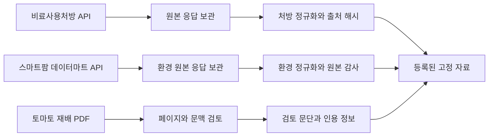
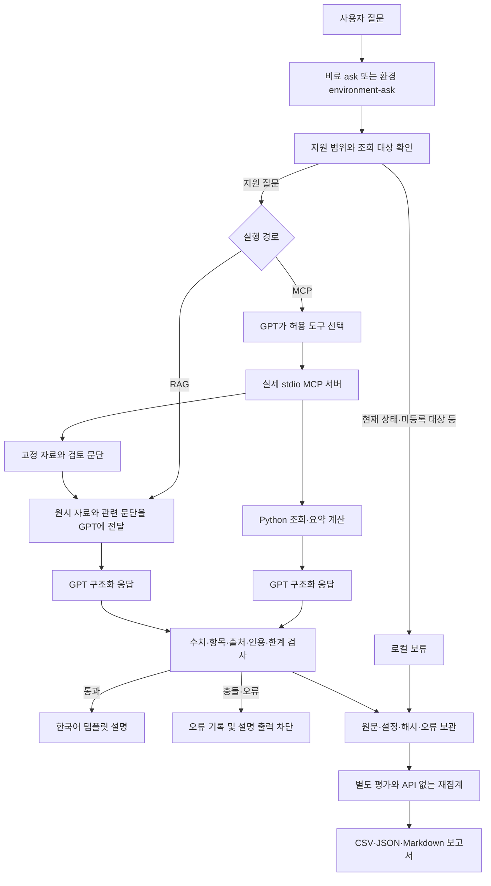

# 농업 데이터·재배문서 기반 MCP/RAG 시스템 정리

**기준일: 2026년 11월 16일**  
**현재 단계: 실제 API 자료 연결, 문헌 기반 질의응답, 고정 조건 반복 평가까지 완료**

이 문서는 전체 시스템, 지금까지의 작업, 실제 결과, 남은 한계와 앞으로의 우선순위를 한곳에 정리한 현황 문서다.
진행 순서대로 누적한 [인수인계 기록](docs/HANDOFF.md)과 달리 최신 상태를 기준으로 설명한다.
이 문서 작성 시점에 실행 중인 실험은 없다. 아래 향후 작업은 계획이며 아직 구현하지 않은 항목이다.

## 1. 어떤 시스템인가

농업 API에서 확보한 자료와 토마토 재배문서를 GPT에 제공하고, **MCP 도구를 사용하는 경로와 자료를 직접 전달하는 RAG 경로를 비교하는 연구용 Python 프로토타입**이다.

현재 사용자가 할 수 있는 작업은 두 가지다.

1. **비료 처방 조회·설명:** 저장된 공급자 처방의 질소·인산·칼리·퇴비량, 단위, 출처, 자료 한계를 확인한다.
2. **과거 환경자료·문헌 질의응답:** 스마트팜 데이터마트의 온도·습도·CO₂ 기록과 관련 토마토 재배문단을 함께 확인한다.

현재 구현은 CLI와 로컬 MCP 서버 중심이다. 웹 화면이나 운영 서버 배포는 아직 없다.
직접 센서를 연결하지 않고 스마트팜 데이터마트 API에서 받은 자료를 사용한다.
실험에서는 같은 조건으로 비교하기 위해 저장된 고정 스냅샷을 읽는다. 매 질문마다 외부 농업 API를 재호출하지 않는다.

### 처음 목표에서 현재 범위로 바뀐 점

| 구분 | 내용 |
|---|---|
| 최초 연구 구상 | 동일 자료·기준을 이용한 RAG 직접 판단과 MCP/Python 규칙 판단 비교 |
| 현재 비료 과제 | 공급자가 계산한 비료 처방의 전달 정확성·근거 추적·반복 일관성 비교 |
| 현재 환경 과제 | 과거 환경값의 조회·요약 계산과 문헌 인용·한계 고지 보존 비교 |
| 관수 | 노지·시설·토경·수경 등 적용 차이를 고려해 사용자 결정으로 현재 범위에서 제외 |
| 직접 센서 연결 | 계획의 전제로 두지 않음. 데이터마트 자료 활용 |
| 실제 제어·농업 적합성 판단 | 단위·적용 조건이 미확인인 항목은 보류 |

현재 결과를 실제 농업 판단 정확도나 MCP 프로토콜 자체의 우월성으로 표현하지 않는다.
비료 조회는 자체 시비량 계산이 아니며, 환경 질의응답도 현재 온실의 환기·난방 명령을 결정하지 않는다.

## 2. 전체 구성과 처리 흐름

### 자료 확보와 보관



### 질문 처리와 평가



사용자가 명령으로 비료/환경 경로와 MCP/RAG 방식을 선택한다.
모든 분야를 하나의 모델이 자유롭게 분류하는 통합 상담 라우터까지 만든 것은 아니다.
지원 범위와 주제 분기는 제한된 로컬 키워드 규칙이며, 이를 GPT의 질문 이해 정확도로 계산하지 않는다.

### MCP와 RAG는 무엇이 다른가

| 항목 | MCP 경로 | 현재 RAG 경로 |
|---|---|---|
| 자료 전달 | GPT의 함수 호출을 통해 MCP 서버가 반환 | 앱이 선택한 자료·문단을 GPT 입력에 포함 |
| 비료 | 저장된 정규화 처방을 도구로 조회 | 같은 처방 문서를 PNU·작물 조건으로 검색 |
| 환경 수치 | Python이 건수·최솟값·최댓값을 계산해 도구로 반환 | 실모델이 선택된 원시 관측값에서 계산 |
| 문헌 | 도구가 주제·토마토 유형별 문단을 반환 | 같은 문단을 직접 전달 |
| 최종 검사 | 공통된 구조화 계약 검사 | 같은 검사 |

현재 RAG 검색은 등록 자료의 메타데이터 필터다. 임베딩·벡터 검색이나 PDF 전체의 범용 의미 검색은 아직 없다.
환경 RAG 입력에 Python이 계산한 건수·최솟값·최댓값 정답을 넣지 않는다.
출력할 항목 코드와 인용 ID는 요청·검색 범위에서 정해 양쪽에 제공하며, 숫자 정답이나 평가 라벨을 모델에 전달하지 않는다.

## 3. 현재 확보한 자료

### 3.1 비료 처방

| 항목 | 현재 자료 |
|---|---|
| 필지 | 완주군 이서면 용서리 528-33 |
| PNU | `5271033027105280033` |
| 시험 작물 | 토마토(시설), 코드 `04017` |
| 원본 | [공급자 응답](data/references/fertilizer/wanju_tomato_20261115.json) |
| 정규화 | [비료 스냅샷](data/snapshots/wanju_fertilizer.json) |
| 밑거름 N/P/K | 14.4 / 3.0 / 3.0 kg/10a |
| 웃거름 N/P/K | 10.9 / 0.0 / 0.0 kg/10a |
| 퇴비 4종 | 각각 0 kg/10a |

이 값은 공급자 API가 반환한 처방이다. 해당 필지의 실제 재배 작물·토양검정일·적용 적합성은 미확인이다.
공급자 처방을 독립적인 농업 정답으로 삼아 자체 시비 계산의 정확도를 주장하지 않는다.
현재 자료에는 비료량 결측이 없으며, 실제 결측 비료량에 대한 모델 성능을 측정한 것은 아니다.

### 3.2 스마트팜 데이터마트 환경자료

| 항목 | 현재 자료 |
|---|---|
| 시설 ID | `PFS_0000001_01` |
| 관측 날짜 | **2023-07-25** |
| 품목 | 토마토, 코드 `080300` |
| 참고 작기 | 5957, 2022-09-21∼2023-07-25 |
| 스냅샷 | [환경자료](data/snapshots/smartfarm_environment_20230725.json) |
| 비료 필지와 연결 | 동일 농장이라는 근거 없음 |

| 코드 | 항목명 | 레코드 | 원시 최솟값 | 원시 최댓값 |
|---|---|---:|---:|---:|
| TI | 내부온도 | 24 | 24.67 | 32.33 |
| HI | 내부습도 | 24 | 76.33 | 97.00 |
| HI02 | 내부 상대습도 | 0 | null | null |
| CI | 내부 CO₂ | 24 | 401.00 | 506.00 |

수치가 있는 기록은 합계 72건이다. 실제 응답과 확인한 명세에서 단위·시간대·집계 방식을 확정하지 못했으므로 위 원시값에 ℃·%·ppm을 붙이지 않았다.
HI를 상대습도로 자동 해석하거나 HI02의 자료 없음을 0으로 바꾸지 않는다.
같은 사용자·작기 기간 안의 날짜라는 연결만 확인했으며 해당 시설과 작기의 직접 매핑까지 확정한 것은 아니다.
기록 시각이 한 시간 간격이라는 사실은 한 시간 평균이나 센서 측정 주기를 뜻하지 않는다.

### 3.3 토마토 재배문서

자료는 농촌진흥청 『농업기술길잡이 106 토마토』, 2020-12-18 개정9판 1쇄, PDF 364쪽이다.
환경 질의응답용으로 검토한 5개 문단을 [문헌 자료집](data/references/tomato_environment.json)에 등록했다.

| PDF / 인쇄 쪽 | 등록한 내용 |
|---|---|
| 41 / 38 | 생장·발달·착과에 적합한 온도 범위 |
| 77 / 74 | 일반토마토의 시간대별 온도관리와 별도 변온관리 문맥 |
| 91 / 88 | 방울토마토의 시간대별 온도관리 |
| 42 / 39 | 공기습도 참고 범위 |
| 42 / 39 | CO₂·광조건 설명, 단위 병기와 상한 설명은 추가 검토 |

일반토마토·방울토마토, 적응성 범위·재배 관리 일정을 구분한다.
등록 문단을 참고용으로 제시하는 것과 실제 시설에 적용 가능한 제어 규칙으로 승인하는 것은 별개다.

### 3.4 보관 중인 자료와 기능

관수 규칙 엔진·합성 관수 사례·문헌 검토는 보관하지만 현재 평가 범위에서 제외했다.
기상 API는 초기 연결 탐색과 자료 조회 기록이 있으나 현재 비료/환경 질의응답에 연결하지 않았다.
스마트팜 자료·기상 자료·비료 필지를 지역명만으로 하나의 농장으로 결합하지 않는다.

## 4. 지금까지 완료한 작업

| 단계 | 완료한 내용 |
|---|---|
| 초기 설계 | 공통 입력·규칙·출력 구조와 MCP/RAG 비교 구상 정리 |
| 규칙 MVP | 합성 관수 판정 함수, 경계·단위·결측·출처 검사 구현 |
| 실제 MCP | stdio 세션 초기화, 도구 목록 조회·호출·오류 차단 구현 |
| 외부 API 탐색 | 비료·스마트팜·기상 서비스의 성공·자료 없음·형식 오류를 구분해 기록 |
| 비료 정규화 | 성공한 필지 선택 후 Decimal·0/결측·단위·출처를 보존하는 어댑터 구현 |
| GPT 연결 | Mock과 실제 GPT의 함수 선택·도구 호출·구조화 응답·검증·기록 구현 |
| 비료 RAG | 같은 처방을 도구 대신 모델 입력에 직접 제공하는 경로 구현 |
| 비료 반복 평가 | 고정 질문·참조값·조건으로 실제 GPT 10회 반복, 원시 응답 평가·CSV·재집계 구현 |
| 관수 문헌 검토 | 유지 범위와 개시점을 구분하고 부호·함수율 종류·원문 표기 문제 검토 |
| 범위 조정 | 사용자 결정으로 관수를 제외하고 데이터마트 환경자료 활용으로 확장 |
| 환경자료 연결 | `.env` 서비스키로 소량 실조회, 72건 보관·정규화·CLI/MCP 조회 구현 |
| 문헌 질의응답 | 온도·습도·CO₂와 일반/방울토마토별 근거 문단을 함께 보여주는 경로 구현 |
| 출력 계약 보완 | 인용 누락·추가 항목·수치 null 대체·잘못된 도구 인자를 차단하고 요청 범위 명시 |
| 독립 원본 감사 | 앱 정규화기와 별도로 원본 요청·응답·시각·수치·고정 참조값을 대조 |
| 환경 반복 평가 | 고정 코드·자료·문헌·모델에서 질문별 10회 반복, 실패 포함 집계·재현 확인 |

현재 전체 자동 테스트는 **237개 통과**다. 과거 단계의 테스트 개수와 최신 개수는 구분한다.

## 5. 실제 실험 결과

### 5.1 비료 처방 전달

실제 GPT로 질문 4개를 각 경로에서 10회씩 실행했다.

| 항목 | MCP | RAG |
|---|---:|---:|
| 모델 처리 시도 | 40 | 40 |
| 검증된 전달 | **38/40** | **39/40** |
| 네트워크 실패 | 2 | 1 |
| 받은 최종 응답의 수치·단위·출처·고지 일치 | 38/38 | 39/39 |
| 미등록 필지·작물 로컬 보류 | 20/20 | 20/20 |

실패 3건은 모두 연결 오류다. 성공한 응답에서 값 왜곡이 없었다는 것과 전체 실행이 모두 성공했다는 것은 구분한다.
상세: [비료 결과 보고서](docs/fertilizer_delivery_results.md), [종합 CSV](outputs/fertilizer_delivery/combined_20261116/results.csv).

### 5.2 환경자료·문헌 질의응답

실제 GPT로 전체 조회·일반토마토 온도·방울토마토 온도·습도·CO₂ 질문을 각 경로에서 10회씩 실행했다.

| 항목 | MCP | RAG |
|---|---:|---:|
| 모델 처리 시도 | 50 | 50 |
| 원시 수치·항목 구성 보존 | 47/50 | 49/50 |
| 문헌 인용 보존 | 50/50 | 50/50 |
| 한계 고지·판단 보류 보존 | 50/50 | 50/50 |
| 시설·날짜·근거 해시 보존 | 50/50 | 50/50 |
| 검증된 전달 | **47/50** | **49/50** |
| 연결 실패 | 0 | 0 |
| 로컬 보류 | 40/40 | 40/40 |

오류 4건은 모두 검사기가 차단했다. MCP 3건은 Python 도구가 정상 값을 반환했지만 GPT가 최솟값·최댓값을 null로 바꾼 사례다.
RAG 1건은 습도 질문에 요청하지 않은 항목을 추가한 사례다. 이를 모두 산술 오류나 MCP 도구 계산 오류로 분류하지 않는다.
성공한 환경 응답도 `partial`이며, 과거 자료와 문헌은 제시하지만 수치 적합성·설비 제어 판단은 보류했다는 뜻이다.

| 질문 | MCP 전달 | RAG 전달 | MCP 반복 일관성 | RAG 반복 일관성 |
|---|---:|---:|---:|---:|
| 전체 조회 | 8/10 | 10/10 | 0.8 | 1.0 |
| 일반토마토 온도 | 10/10 | 10/10 | 1.0 | 1.0 |
| 방울토마토 온도 | 9/10 | 10/10 | 0.9 | 1.0 |
| 습도 | 10/10 | 9/10 | 1.0 | 0.9 |
| CO₂ | 10/10 | 10/10 | 1.0 | 1.0 |

반복 일관성은 정규화한 원시 구조화 응답의 최빈 값 횟수/전체 시도다. 일관되게 틀린 답변도 일관적일 수 있어 전달 성공률과 따로 본다.
상세: [환경 실험 보고서](docs/environment_experiment.md), [실제 GPT CSV](outputs/environment_experiment/20261116T090711642205Z/results.csv).

### 5.3 결과를 해석할 때 지키는 기준

- 비료는 한 필지·한 작물의 저장 처방, 환경은 한 시설·하루의 기록과 고정 문단을 사용했다.
- 표현이 다른 질문 여러 개를 독립적인 농장 여러 개로 세지 않는다.
- 로컬 보류는 모델이 답변한 사례가 아니므로 모델 점수의 분모에서 제외한다.
- 모델 오류·연결 실패·검증 충돌·누락 로그를 실패 분모에 남기고 자동 재시도나 정답 대체를 하지 않는다.
- 반복 실험 중 코드를 바꾸지 않았으며 초기 개발 점검과 최종 고정 버전 결과를 합산하지 않는다.
- Mock은 경로와 기록을 시험하는 결정적 대역이며 실제 GPT 성능 결과가 아니다.
- 원시 모델 응답을 평가하며 한국어 템플릿 출력으로 모델 오류를 가리지 않는다.
- 두 방식의 인과적 우열, 실제 농업 판단 정확도, 범용 문헌 검색 성능을 입증한 결과는 아니다.

## 6. 핵심 파일과 역할

| 영역 | 주요 파일 |
|---|---|
| 실행 명령 | [cli.py](src/agri_dss/cli.py) |
| 모델 연결·설정 | [llm.py](src/agri_dss/llm.py), [llm.json](configs/llm.json) |
| 비료 어댑터·설명 검사 | [fertilizer.py](src/agri_dss/fertilizer.py), [explanation.py](src/agri_dss/explanation.py) |
| 비료 MCP/RAG 질의 | [assistant.py](src/agri_dss/assistant.py), [rag.py](src/agri_dss/rag.py), [routing.py](src/agri_dss/routing.py) |
| MCP 서버 | [mcp_server.py](src/agri_dss/mcp_server.py) |
| 데이터마트 연결·정규화 | [smartfarm.py](src/agri_dss/smartfarm.py) |
| 환경 문헌·요약 | [environment_context.py](src/agri_dss/environment_context.py) |
| 환경 GPT 질의 | [environment_assistant.py](src/agri_dss/environment_assistant.py) |
| 독립 원본 감사 | [environment_audit.py](src/agri_dss/environment_audit.py) |
| 비료 평가 | [compare_fertilizer_paths.py](scripts/compare_fertilizer_paths.py), [평가 모듈](src/agri_dss/fertilizer_evaluation.py) |
| 환경 반복 평가 | [run_environment_experiment.py](scripts/run_environment_experiment.py) |
| 질문·참조값 | [비료 사례](configs/scenarios/fertilizer_delivery.json), [환경 사례](configs/scenarios/environment_qa.json) |

주요 MCP 도구는 `get_fertilizer_prescription`, `get_environment_data`, `get_environment_context`다.
비료·환경의 각 모델 루프에는 해당 경로에서 허용한 도구만 제공한다.
관수의 `get_soil_data`, `evaluate_irrigation`은 과거 합성 시험용으로 보관한다.

## 7. 실행 방법

프로젝트 루트 `C:\code\agbot_mcp_20261114`의 PowerShell에서 실행한다.

```powershell
$env:PYTHONPATH = 'src'
$env:PYTHONIOENCODING = 'utf-8'

# 저장 자료만 조회: 외부 호출 없음
python -m agri_dss fertilizer
python -m agri_dss environment

# Mock: 모델 API 없이 동작 확인
python -m agri_dss ask --provider mock --path mcp
python -m agri_dss environment-ask --provider mock --path rag

# 실제 GPT 질의
python -m agri_dss ask --provider openai --path mcp
python -m agri_dss environment-ask --provider openai --path rag --question "과거 습도 자료와 토마토 문헌 근거를 보여줘."

# 자동 테스트
python -m pytest -q
```

모델 설정은 `gpt-5.4-mini-2026-03-17`, reasoning `none`, 응답당 출력 최대 1,800토큰, 실행당 모델 최대 3회·도구 최대 2회다.
Python 3.11 이상과 pydantic·requests·MCP SDK 등을 사용한다. 새 환경 설치는 [README](README.md)의 설치 절차를 따른다.

실제 GPT는 `OPENAI_API_KEY`, 데이터마트 전용 클라이언트는 `SMARTFARM_API_KEY` 또는 `smartfarm_data`를 환경 변수/로컬 `.env`에서 읽는다.
키 값은 이 문서에 포함하지 않았다. 키를 포함한 실제 요청 URL 대신 마스킹·템플릿 기록을 보존한다.

### API 없이 기존 실험을 재집계

```powershell
python scripts/compare_fertilizer_paths.py --analyze outputs/fertilizer_delivery/20261116T062729068253Z
python scripts/compare_fertilizer_paths.py --analyze outputs/fertilizer_delivery/20261116T063042523842Z
python scripts/run_environment_experiment.py --analyze outputs/environment_experiment/20261116T090711642205Z
```

실패가 포함된 실험의 종료코드 1과 `all_passed=false`는 실패를 보존한 평가 결과다. 자동 테스트의 코드 오류와 구분한다.

## 8. 기록·재현 상태

실행별로 원시 모델 응답, 도구/검색 기록, 설정, 자료·문헌·코드·프롬프트 해시, 실행 시각·시간과 오류를 보관한다.
공급자가 반환한 usage도 원문에 남긴다. API 없는 재집계에서 요약 파일 해시가 동일함을 확인했다.

| 자료 | 위치 |
|---|---|
| 비료 종합 결과 | [보고서](docs/fertilizer_delivery_results.md), [종합 CSV·요약](outputs/fertilizer_delivery/combined_20261116/) |
| 환경 반복 결과 | [실험 폴더](outputs/environment_experiment/20261116T090711642205Z/) |
| 환경 독립 감사 | [audit.json](outputs/environment_experiment/20261116T090711642205Z/audit.json) |
| 환경 단위·시각 검토 | [검토 기록](data/references/environment_metadata_review.json) |
| 환경 문헌 사용법 | [문서](docs/environment_literature_qa.md) |
| 관수 문헌 보관 기록 | [검토 보고서](docs/tomato_literature_review.md) |
| 전체 진행 이력 | [HANDOFF](docs/HANDOFF.md) |

저장소는 [202116302/ag_bot_mcp](https://github.com/202116302/ag_bot_mcp)다.
2026-11-17 사용자 요청에 따라 소스·문서·첨부 PDF·마스킹된 원본·`outputs/` 실험 결과를 함께 버전 관리하도록 변경했다.
인증키·`.env`·로컬 도구·캐시는 제외한다. 파일 해시를 보존하기 위해 줄바꿈 자동 변환을 사용하지 않는다.
완전히 잠긴 의존성 환경, 별도 배포·운영 환경과 웹 UI는 아직 구성하지 않았다.

## 9. 앞으로 할 작업과 우선순위

아래는 제안된 순서이며 완료된 기능이 아니다. 현재 관수를 다시 포함하거나 직접 센서 연결을 요구하지 않는다.

| 우선순위 | 작업 | 구체적인 목표 | 완료 확인 기준 |
|---|---|---|---|
| **1** | 출력 계약 강화 | 요청한 항목만 반환하고 자료가 있는 원시 숫자를 null로 바꾸지 못하도록 스키마·계약 보완 | 기존 오류를 재현한 회귀 테스트 통과, 수치·인용을 주입하지 않는 RAG 조건 유지 |
| **2** | 새 버전 비교 실험 | 개선 전후를 별도 코드 버전으로 고정하고 같은 질문·자료에서 다시 평가 | 원문·실패를 보존한 비교표, 이전 결과와 구분된 실행 폴더 |
| **3** | 환경자료 의미 확인 | 해당 서비스/시설의 단위, HI 의미, 시간대, 집계 방식을 출처로 확정 | 근거와 적용 범위를 기록한 메타데이터. 미확인 항목은 계속 보류 |
| **4** | 자료 다양화 | 여러 시설·날짜·필지·작물과 실제 자료 없음/결측 사례 확보 | 원본·조건·독립 참조값을 갖춘 추가 자료집, 조회 범위·호출 상한 기록 |
| **5** | 등록·선택 로직 일반화 | 현재 고정 ID·날짜를 여러 등록 스냅샷 선택으로 확장 | 다른 대상을 기본값으로 치환하지 않는 조회·검증 테스트 |
| **6** | 문헌 범위 확장 | 검토 문단을 늘리고 품종·작형·단계·시간대·측정 변수로 구분 | 페이지·문맥이 확인된 자료집과 검색 정답 사례. 범용 검색은 별도 평가 |
| **7** | 조건부 범위 판단 | 단위·변수·적용 조건이 확인된 항목에 한해 문헌 범위와 비교 | 독립 검토한 규칙·정답과 경계/누락/단위 오류 시험. 조건 미확인 시 보류 |
| **8** | 결과 공유·사용성 | 실제 결과 기반 도표·구성도·포스터 자료, 간단한 UI와 재현 환경 정리 | 로그에서 재생성되는 결과물, 실행 가이드와 의존성 고정 |

### 가장 먼저 권장하는 작업

**출력 계약을 강화한 새 버전을 만들고 현재 반복 실험과 비교하는 것**이 우선이다.
이번에 실제로 발견한 문제는 연결 오류보다 모델이 원시 숫자를 비우거나 요청하지 않은 항목을 추가하는 경우였다.
MCP 도구의 정상 계산과 GPT의 설명 전달을 분리해 다룰 필요가 있다.

RAG 스키마에 Python이 계산한 정답 숫자를 넣어 오류를 없애면 원래 비교 조건이 달라지므로 그렇게 처리하지 않는다.
구조·자료 유무·항목 범위의 제약과 숫자 정답 제공은 구분해야 한다.
스키마 보완이나 MCP의 결정적 출력 보존 방식을 바꿀 경우 이를 새로운 시스템 버전·비교 조건으로 명시한다.

### 아직 계획에 넣지 않은 범위

관수 재개, 실시간 센서 연결, 환기창·난방기 등의 물리적 제어, 실제 필지의 자동 시비 처방,
미확인 환경값에 대한 농업 적합성 단정은 현재 계획의 전제가 아니다.

## 10. 현재 상태 요약

**API 원본 확보 → 정규화·독립 감사 → 검토 문헌 연결 → MCP/RAG 질의응답 → 응답 검사 → 반복 평가·재집계**까지 구현했다.
현재는 원본과 문헌을 얼마나 충실하게 조회·계산·전달하는지를 검증하는 연구 프로토타입이다.
다음 단계는 발견한 출력 오류를 줄이는 계약 개선과 새 버전 평가이며, 자료·문헌 범위 확장과 조건부 판단은 그 뒤에 진행한다.
